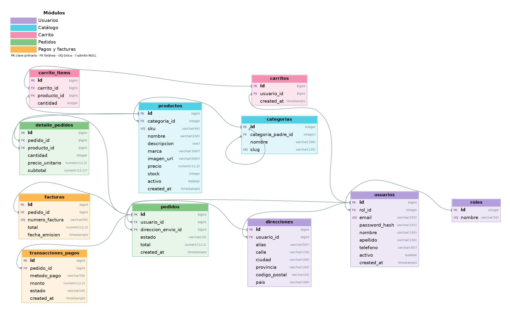

# Base de datos E-commerce (PostgreSQL + Docker)

Esquema básico de 11 tablas: usuarios, catálogo, carrito, pedidos, pagos y facturas.



## Requisitos
- Docker Desktop (`docker compose version` debe funcionar)

## Inicio rápido (PowerShell)
```powershell
git clone https://github.com/RobertoManzaraz/cocodevs-db.git
cd cocodevs-db
copy .env.example .env      # luego editá .env y poné una contraseña
docker compose up -d
```

Verificar:
```powershell
docker exec -it ecommerce_db psql -U ecommerce_admin -d cocodevs-db -c "\dt"
```

## Conexión
Host `localhost` · Puerto `5432` · Base `cocodevs-db` · Usuario `ecommerce_admin` · Contraseña la de tu `.env`

## Borrar todo y volver a cargar el esquema
```powershell
# Opción A: borra también el volumen (más simple)
docker compose down -v
docker compose up -d

# Opción B: sin tocar el contenedor
docker cp db\reset.sql ecommerce_db:/tmp/reset.sql
docker cp db\init\01_schema.sql ecommerce_db:/tmp/01_schema.sql
docker cp db\init\02_seed.sql ecommerce_db:/tmp/02_seed.sql
docker exec ecommerce_db psql -U ecommerce_admin -d cocodevs-db -v ON_ERROR_STOP=1 -f /tmp/reset.sql -f /tmp/01_schema.sql -f /tmp/02_seed.sql
```

## Estructura
```
.
├── docker-compose.yml
├── .env.example
├── diagrama.png
└── db/
    ├── reset.sql
    └── init/
        ├── 01_schema.sql
        └── 02_seed.sql
```
